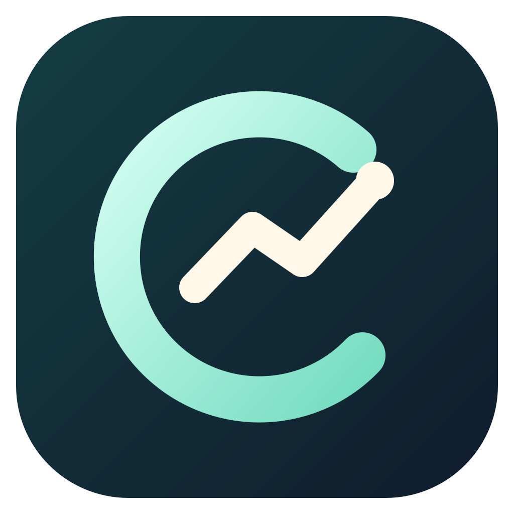
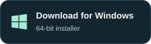

<p align="center"></p>

# Clarity

### See your spending. Plan your saving.

Your money is personal. Your money tracker should be too.

**No signup. No bank connection. Your financial records stay in local files.**

Clarity helps you understand where your money goes, spot overspending, and plan what to save. Import your CSV statements, organize your categories, and see your finances clearly—without creating a Clarity account or uploading your ledger to a company’s cloud.

Everything you record is saved in a Markdown vault on your computer. You choose where it lives, how to back it up, and which tools you use to open it.

**macOS · Windows · Self-hosted web app**

## Install Clarity

Desktop installers include everything needed to run the app. No Node.js, terminal, or database setup is required.

<p>
  <a href="https://github.com/rajatmangal/Clarity/releases/download/latest/Clarity-mac-arm64.dmg"></a>
  <a href="https://github.com/rajatmangal/Clarity/releases/download/latest/Clarity-mac-x64.dmg"></a>
  <a href="https://github.com/rajatmangal/Clarity/releases/download/latest/Clarity-windows-x64.exe"></a>
</p>

Prefer a browser or your own server?

<p>
  <a href="#run-in-your-browser"></a>
  <a href="#host-your-own-server"></a>
</p>

The buttons always download the [latest successful build from main](https://github.com/rajatmangal/Clarity/releases/tag/latest). They update automatically after tests and all platform builds succeed. For earlier versioned builds, visit [Releases](https://github.com/rajatmangal/Clarity/releases). Installers are attached to GitHub Releases rather than stored in the source repository.

**Build status:** these are unsigned preview builds. Apple Silicon launch has been checked; Windows and Intel installers still need native-device validation. Operating systems may show publisher warnings. Signing and Apple notarization are not configured yet.

On **Mac**, open the DMG and drag Clarity into Applications. On **Windows**, run the installer and follow its prompts. On first launch, create a new vault or select an existing Clarity vault. Close any other Clarity instance using that vault first.

## Why keep your money tracker local?

- **Start without an account.** Open Clarity and get going. No Clarity signup, email address, or bank credentials are needed.
- **Keep your ledger off our servers.** Clarity has no hosted account database or cloud vault. In desktop and localhost mode, your records stay on your computer.
- **Use it offline.** Import statements, categorize transactions, set budgets, and explore charts without an internet connection. Optional AI needs internet access.
- **Keep control of your files.** Your transactions, budgets, categories, balances, and settings are readable Markdown. Open them in Obsidian, move the folder, or keep using the data outside Clarity.
- **Choose your own backup.** Clarity keeps local recovery snapshots. You decide whether to add an external drive, encrypted backup, or your own sync service.
- **Understand your spending sooner.** Saved CSV mappings and remembered merchant categories reduce repeat work, so you can focus on where to cut back and how your balances change.

**Cloud use is your choice:** Clarity does not automatically upload or sync your vault. If you place it in a cloud-synced folder or host Clarity on a cloud server, those files live with the provider you choose. If you enable OpenAI categorization, selected descriptions and category examples are sent to OpenAI. AI is optional; the rest of the app works without an API key.

## What you can do

- **See spending clearly:** monthly, yearly, and custom date ranges; income, spending, and tracked net worth.
- **Import your statements:** map CSV columns, preview dates and amounts, review duplicates, and reuse saved account mappings.
- **Categorize faster:** remembered merchant choices, bulk merchant categorization, and optional OpenAI suggestions.
- **Plan your budget:** categories and subcategories, combined or separate limits, and temporary adjustments for one month.
- **Explore useful charts:** cash flow, category mix, budget trends, budget versus actual, top merchants, and daily spending. Pin what matters and hide the rest.
- **Keep records current:** manual transactions, editing, bulk deletion, and dated account balance snapshots.
- **Make it yours:** eight themes, a display name, and a currency dropdown with CAD, USD, and INR favourites.

## Your first five minutes

On first launch, Clarity walks you through your name (optional), currency, vault folder, and theme. It explains what each file holds, where backups live, and how optional AI works. Review your choices before finishing; changing the folder moves the current vault only after you confirm. Reopen the guide from **Settings → Open setup guide** anytime.

1. Open **Settings** and choose your currency before adding transactions or balances. CAD is the default.
2. Add an account, then choose **Import statement** and select its CSV.
3. Tell Clarity whether it is a bank/debit or credit-card statement. Map the date, description, and amount columns and review the preview.
4. Assign categories and import the selected rows. Approved merchant choices are remembered.
5. Set a few budgets and add account balances to start tracking your progress.

Credit-card purchases count as spending; repayments are transfers. Refunds reduce spending. Balance snapshots are entered separately from transactions. Clarity tracks one currency per vault and does not convert currencies.

## Your data stays yours

Your vault is a folder of Markdown files for transactions, accounts, categories, budgets, balances, preferences, and import mappings. Open it in Obsidian or back it up with your own tools. Settings shows its location and lets you move it; desktop builds include a native folder picker.

Clarity keeps the latest 30 automatic table snapshots and protects against conflicting saves. These are local recovery copies, so keep a separate backup too. Vault files are plaintext. There is no bank connection, cloud account requirement, or automatic synchronization between installations.

**Optional AI:** connect your own OpenAI key in Settings. Categorization sends selected descriptions, category labels, and reviewed examples to OpenAI; it does not send balances or transaction amounts. API charges apply. Desktop keys use operating-system encryption; browser/server keys stay in a local `.env` file. Keys never go into your Markdown vault. Core tracking works without AI.

## Run in your browser

For developers or users who prefer localhost, install Node.js 22 or newer, then run these commands from the project folder:

```sh
npm ci
npm run build
npm start
```

Open **http://localhost:4310**. The default server listens only on your computer. For development, use `npm run dev` instead.

## Host your own server

Clarity also runs as a single-user web app for access from other devices. Configure a server password, public origin, and vault path in `.env`, then run `npm run start:server` after building. Use HTTPS through a reverse proxy for remote access.

A Dockerfile and Compose configuration are included. The default Compose port is bound to localhost, and data persists in the `clarity-data` volume. Server folders belong to the server, so remote clients use a path field instead of a desktop folder picker.

See the **[server setup guide](docs/USER_GUIDE.md#server-browser-access-from-other-devices)** for configuration and Docker instructions.

## Build and test

```sh
npm test                    # Unit tests
npm run desktop:prepare     # Build the standalone app runtime
npm run test:integration    # Test an isolated server and authenticated writes
npm run desktop:run         # Open the prepared Electron app
npm run desktop:mac         # Build Apple Silicon and Intel DMGs
npm run desktop:windows     # Build the Windows x64 installer
```

Build installers on their destination operating system for release validation. Outputs go into `release/`. The included GitHub Actions workflow builds and uploads installer artifacts on every push to `main`, manual runs, and `v*` tags. Successful `main` builds update the rolling **Latest build** prerelease with permanent download URLs used by the buttons above. Failed checks or builds leave the previous published download in place. Builds on the same branch run in sequence to avoid older builds replacing newer ones. Version tags publish separate versioned prereleases. Manual runs on `main` also update the rolling release; runs on other branches provide Actions artifacts only. Desktop updates are installed manually.

Built with **Next.js, React, Electron, Recharts, and Lucide**. A Markdown vault replaces a database server.

## Help and detailed documentation

- [CSV imports and date formats](docs/USER_GUIDE.md#import-statements)
- [Markdown vault layout and recovery](docs/USER_GUIDE.md#markdown-storage)
- [Budgets and Analysis](docs/USER_GUIDE.md#monthly-adjustments-and-analysis)
- [Desktop setup](docs/USER_GUIDE.md#desktop-macos-and-windows)
- [Server setup](docs/USER_GUIDE.md#server-browser-access-from-other-devices)

**Ambiguous date?** If `09/10/2026` cannot be inferred safely from the statement, select Day first or Month first. **Currency locked?** Existing transactions or balances must be removed before changing currency; Clarity does not reinterpret recorded amounts. **Vault already open?** Close the other Clarity process before opening the same vault.
