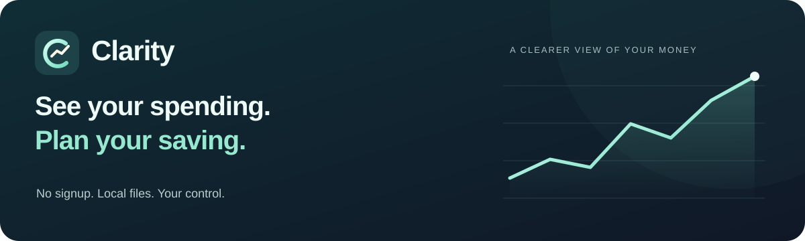

<p align="center">
  
</p>

<h1 align="center">Clarity</h1>
<p align="center"><strong>Your money, with a clearer picture.</strong><br>Personal finance for macOS, Windows, and your own server.</p>

<p align="center">
  <a href="#install-clarity">⬇️ Download</a> ·
  <a href="#first-launch-macos-and-windows">🔓 First launch</a> ·
  <a href="#what-you-can-do">✨ Features</a> ·
  <a href="#your-data-stays-yours">🔒 Your data</a> ·
  <a href="docs/USER_GUIDE.md">📖 User guide</a>
</p>

---

<h2 align="center"><strong>🔒 No databases. No cloud vault. Your financial records stay on your computer.</strong></h2>

<p align="center"><strong>Clarity stores your records in readable Markdown files—not a database.<br>No signup. No bank connection. No financial records uploaded to Clarity servers.</strong></p>

**In desktop and localhost mode, importing statements, managing transactions, setting budgets, and viewing charts all happen on your computer. These features work offline and do not send your financial records to an external server.**

**OpenAI is entirely optional.** Only if you connect your own API key and request AI categorization are selected descriptions, category labels, and reviewed examples sent to OpenAI. Core tracking does not need a key.

Desktop update checks contact GitHub without sending your financial records; you can turn automatic checks off in **Settings → App updates**. If you choose a cloud-synced vault folder or host Clarity on a remote server, your files live in that location instead.

---

Your money is personal. Your money tracker should be too.

**No signup. No bank connection. Your financial records stay in local files.**

Clarity helps you understand where your money goes, spot overspending, and plan what to save. Import your CSV statements, organize your categories, and see your finances clearly—without creating a Clarity account or uploading your ledger to a company’s cloud.

Everything you record is saved in a Markdown vault on your computer. You choose where it lives, how to back it up, and which tools you use to open it.

**macOS · Windows · Self-hosted web app**

## ⬇️ Install Clarity

<a id="install-clarity"></a>

Desktop installers include everything needed to run the app. No Node.js, terminal, or database setup is required.

> [!IMPORTANT]
> ## 🔓 Before you download: first-launch steps
>
> **Clarity is a free preview without Apple-verified signing/notarization or Windows publisher signing. Your computer may ask you to approve it.**
>
> **🍎 Mac:** Open the DMG → drag **Clarity into Applications** → open Clarity. If Apple says it cannot verify the app, click **Done**, then go to **System Settings → Privacy & Security → Open Anyway → Open**.
>
> **🪟 Windows:** Run the installer. If **“Windows protected your PC”** appears, choose **More info → Run anyway**, if available, then follow the installation prompts.
>
> **Only approve a download you trust from this repository.** If approval is unavailable, or the message says the app is damaged or malware was detected, follow the [full installation help](#first-launch-macos-and-windows). Do not disable system-wide protections.

<p>
  <a href="https://github.com/rajatmangal/Clarity/releases/download/latest/Clarity-mac-arm64.dmg"></a>
  <a href="https://github.com/rajatmangal/Clarity/releases/download/latest/Clarity-mac-x64.dmg"></a>
  <a href="https://github.com/rajatmangal/Clarity/releases/download/latest/Clarity-windows-x64.exe"></a>
</p>

Prefer a browser or your own server?

<p>
  <a href="#run-in-your-browser"></a>
  <a href="#host-your-own-server"></a>
</p>

The buttons always download the [latest successful build from main](https://github.com/rajatmangal/Clarity/releases/tag/latest). They update automatically after tests and all platform builds succeed. For earlier versioned builds, visit [Releases](https://github.com/rajatmangal/Clarity/releases). Installers are attached to GitHub Releases rather than stored in the source repository.

**Preview status:** Apple Silicon launch has been checked; Windows and Intel installers still need native-device validation. Download the Apple Silicon build for M-series Macs, or the Intel build for Intel Macs. Find your processor under **Apple menu → About This Mac**.

On **Mac**, open the DMG and drag Clarity into Applications. On **Windows**, run the installer and follow its prompts. On first launch, create a new vault or select an existing Clarity vault. Close any other Clarity instance using that vault first.

<a id="first-launch-macos-and-windows"></a>

## 🔓 First launch: macOS and Windows

A free app can still have a paid publisher certificate. Clarity currently does not, so your operating system may ask you to approve it. An unverified-publisher warning does **not by itself mean malware was detected**, and it is not proof that an app is safe. Proceed only if you trust the download from [this repository’s Releases](https://github.com/rajatmangal/Clarity/releases).

### 🍎 macOS: “Clarity Not Opened”

If the message says **“Apple could not verify ‘Clarity’ is free of malware that may harm your Mac or compromise your privacy”**:

1. Open the downloaded DMG and drag **Clarity into Applications**.
2. Open **Clarity from Applications**. If the warning appears, click **Done**.
3. Open **System Settings → Privacy & Security**, then scroll to the **Security** section.
4. Find the message about Clarity and click **Open Anyway**.
5. Confirm **Open**, and authenticate if macOS asks.

Once approved, macOS remembers the exception and you can normally open Clarity as usual. This is an app-specific exception; there is no need to disable Gatekeeper globally. See [Apple’s official instructions](https://support.apple.com/en-us/102445).

<details>
<summary><strong>A different message, or no “Open Anyway” button?</strong></summary>

**“Clarity is damaged and can’t be opened” is a different warning.** Replace an older download with the current release. If it persists, report the exact message, macOS version, and whether you used Apple Silicon or Intel on [GitHub Issues](https://github.com/rajatmangal/Clarity/issues). Do not assume that approving an unidentified publisher will repair a damaged bundle.

If macOS reports detected malware, or your organization manages the device and blocks approval, do not bypass that block. Use the [localhost option](#run-in-your-browser) where permitted, or ask your administrator.

</details>

### 🪟 Windows: “Windows protected your PC”

Microsoft Defender SmartScreen may warn that Clarity is an unrecognized app or show **Unknown publisher**, because the preview installer is unsigned and may not have an established download reputation.

1. Download the **Windows 64-bit installer** from the buttons above.
2. Open the installer. If SmartScreen shows **Windows protected your PC**, choose **More info**.
3. If you trust this download and **Run anyway** is available, choose it and follow the installer prompts.

**Windows 11 Smart App Control and managed-device policies can block installation without a “Run anyway” option.** This is different from the ordinary SmartScreen warning. Do not turn off antivirus or system-wide protections to install Clarity; use the [localhost option](#run-in-your-browser) where permitted, or ask your administrator. See [Microsoft’s explanation of SmartScreen reputation](https://learn.microsoft.com/en-us/windows/apps/package-and-deploy/smartscreen-reputation) and [Smart App Control](https://support.microsoft.com/en-us/windows/security/threat-malware-protection/smart-app-control-frequently-asked-questions).

---

## 🏡 Why keep your money tracker local?

- **Start without an account.** Open Clarity and get going. No Clarity signup, email address, or bank credentials are needed.
- **Keep your ledger off our servers.** Clarity has no hosted account database or cloud vault. In desktop and localhost mode, your records stay on your computer.
- **Use it offline.** Import statements, categorize transactions, set budgets, and explore charts without an internet connection. Optional AI needs internet access.
- **Keep control of your files.** Your transactions, budgets, categories, balances, and settings are readable Markdown. Open them in Obsidian, move the folder, or keep using the data outside Clarity.
- **Choose your own backup.** Clarity keeps local recovery snapshots. You decide whether to add an external drive, encrypted backup, or your own sync service.
- **Understand your spending sooner.** Saved CSV mappings and remembered merchant categories reduce repeat work, so you can focus on where to cut back and how your balances change.

**Cloud use is your choice:** Clarity does not automatically upload or sync your vault. If you place it in a cloud-synced folder or host Clarity on a cloud server, those files live with the provider you choose. If you enable OpenAI categorization, selected descriptions and category examples are sent to OpenAI. AI is optional; the rest of the app works without an API key.

<a id="what-you-can-do"></a>

## ✨ What you can do

- **See spending clearly:** monthly, yearly, and custom date ranges; income, spending, and tracked net worth.
- **Import your statements:** map CSV columns, preview dates and amounts, review duplicates, and reuse saved account mappings.
- **Categorize faster:** remembered merchant choices, bulk merchant categorization, and optional OpenAI suggestions.
- **Plan your budget:** categories and subcategories, combined or separate limits, and temporary adjustments for one month.
- **Explore useful charts:** cash flow, category mix, budget trends, budget versus actual, top merchants, and daily spending. Pin what matters and hide the rest.
- **Keep records current:** manual transactions, bulk category/account/review editing with change previews, bulk deletion, and dated account balance snapshots.
- **Reuse your filters:** named transaction views for search, category, account, review status, and rolling or fixed date ranges.
- **Make it yours:** eight themes, a display name, and a currency dropdown with CAD, USD, and INR favourites.

**Reinstalling?** Keep your vault folder. Choose **Use an existing vault** on desktop first launch, or **Open existing vault** in setup/Settings. Review its record counts and reopen it in place; your saved records and preferences are preserved. [Reinstall guide](docs/USER_GUIDE.md#reinstalling-and-reopening-your-vault).

## 🚀 Your first five minutes

On first launch, Clarity walks you through your name (optional), currency, vault folder, and theme. It explains what each file holds, where backups live, and how optional AI works. Review your choices before finishing; changing the folder moves the current vault only after you confirm. Reopen the guide from **Settings → Open setup guide** anytime.

1. Open **Settings** and choose your currency before adding transactions or balances. CAD is the default.
2. Add an account, then choose **Import statement** and select its CSV.
3. Tell Clarity whether it is a bank/debit or credit-card statement. Map the date, description, and amount columns and review the preview.
4. Assign categories and import the selected rows. Approved merchant choices are remembered.
5. Set a few budgets and add account balances to start tracking your progress.

Credit-card purchases count as spending; repayments are transfers. Refunds reduce spending. Balance snapshots are entered separately from transactions. Clarity tracks one currency per vault and does not convert currencies.

<a id="your-data-stays-yours"></a>

## 🔒 Your data stays yours

Your vault is a folder of Markdown files for transactions, accounts, categories, budgets, balances, preferences, and import mappings. Open it in Obsidian or back it up with your own tools. Settings shows its location and lets you move it; desktop builds include a native folder picker.

Clarity keeps the latest 30 automatic table snapshots and protects against conflicting saves. **Settings → Data & recovery** lets you create named backups, preview and restore snapshots, export/import a portable vault ZIP, and export all or filtered transactions as CSV. Restoring the current vault keeps a safety copy first. These are local recovery copies, so keep a separate backup too. Vault files and exported ZIPs are plaintext. There is no bank connection, cloud account requirement, or automatic synchronization between installations.

**Optional AI:** connect your own OpenAI key in Settings. Categorization sends selected descriptions, category labels, and reviewed examples to OpenAI; it does not send balances or transaction amounts. API charges apply. Desktop keys use operating-system encryption; browser/server keys stay in a local `.env` file. Keys never go into your Markdown vault. Core tracking works without AI.

<a id="run-in-your-browser"></a>

## 🌐 Run in your browser

For developers or users who prefer localhost, install Node.js 22 or newer, then run these commands from the project folder:

```sh
npm ci
npm run build
npm start
```

Open **http://localhost:4310**. The default server listens only on your computer. For development, use `npm run dev` instead.

<a id="host-your-own-server"></a>

## 🖥️ Host your own server

Clarity also runs as a single-user web app for access from other devices. Configure a server password, public origin, and vault path in `.env`, then run `npm run start:server` after building. Use HTTPS through a reverse proxy for remote access.

A Dockerfile and Compose configuration are included. The default Compose port is bound to localhost, and data persists in the `clarity-data` volume. Server folders belong to the server, so remote clients use a path field instead of a desktop folder picker.

See the **[server setup guide](docs/USER_GUIDE.md#server-browser-access-from-other-devices)** for configuration and Docker instructions.

<a id="updates"></a>

## 🔄 Updates

Installed desktop builds check the rolling GitHub release shortly after launch and every six hours while the app is open. An in-app banner and desktop notification announce a newer build. In **Settings → App updates**, check manually or turn automatic checks off. Checks and downloads contact GitHub; they do not include your vault records, balances, or OpenAI key.

On **Windows**, choose **Download update**, wait for verification, then **Restart and install**. Updates never install automatically when you close Clarity. Finish editing before restarting; your saved vault, preferences, and key remain outside the app installation.

On **macOS**, update notifications work, but unsigned builds show **Open latest download**. Automatic installation requires Developer ID signing. The workflow is prepared for signing and notarization once the repository secrets below are configured. Signing checks remain enabled.

Older Clarity builds do not contain the updater: install an updater-enabled build once from the download buttons above. Local development builds do not check the release service. Browser/server installations are updated by their owner through deployment.

Each `main` CI build gets a unique increasing preview version, including retries. Release uploads include versioned binaries and checksums, with updater manifests uploaded last. The permanent README download filenames remain unchanged.

<details>
<summary><strong>For maintainers: optional release signing</strong></summary>

Configure these **GitHub repository Actions secrets**; never put certificate files or passwords into the repository:

- `MAC_CSC_LINK` and `MAC_CSC_KEY_PASSWORD`: Developer ID Application certificate (base64 PKCS#12 or a secure certificate URL) and its password.
- `APPLE_ID`, `APPLE_APP_SPECIFIC_PASSWORD`, and `APPLE_TEAM_ID`: enable notarization when all three are present.
- `WIN_CSC_LINK` and `WIN_CSC_KEY_PASSWORD`: optional Windows code-signing certificate and password.

Mac ZIP update packages and update metadata are published alongside the DMGs and Windows installer. Versioned update files are retained in the rolling release so a download that has already started can still finish after a newer build is published.

</details>

## 🛠️ Build and test

```sh
npm test                    # Unit tests
npm run desktop:prepare     # Build the standalone app runtime
npm run test:integration    # Test an isolated server and authenticated writes
npm run desktop:run         # Open the prepared Electron app
npm run desktop:mac         # Build Apple Silicon and Intel DMGs
npm run desktop:windows     # Build the Windows x64 installer
```

Build installers on their destination operating system for release validation. Outputs go into `release/`. The included GitHub Actions workflow builds and uploads installer artifacts on every push to `main`, manual runs, and `v*` tags. Successful `main` builds update the rolling **Latest build** prerelease with permanent download URLs used by the buttons above. Failed checks or builds leave the previous published download in place. Builds on the same branch run in sequence to avoid older builds replacing newer ones. Version tags publish separate versioned prereleases. Manual runs on `main` also update the rolling release; runs on other branches provide Actions artifacts only. Desktop builds check for updates automatically and offer an in-app download and restart action where supported. See [Updates](#updates).

Built with **Next.js, React, Electron, Recharts, and Lucide**. A Markdown vault replaces a database server.

## 📖 Help and detailed documentation

- [CSV imports and date formats](docs/USER_GUIDE.md#import-statements)
- [Markdown vault layout](docs/USER_GUIDE.md#markdown-storage)
- [Backups, recovery, and exports](docs/USER_GUIDE.md#backups-recovery-and-exports)
- [Budgets and Analysis](docs/USER_GUIDE.md#monthly-adjustments-and-analysis)
- [Desktop setup](docs/USER_GUIDE.md#desktop-macos-and-windows)
- [Server setup](docs/USER_GUIDE.md#server-browser-access-from-other-devices)

**Ambiguous date?** If `09/10/2026` cannot be inferred safely from the statement, select Day first or Month first. **Currency locked?** Existing transactions or balances must be removed before changing currency; Clarity does not reinterpret recorded amounts. **Vault already open?** Close the other Clarity process before opening the same vault.
