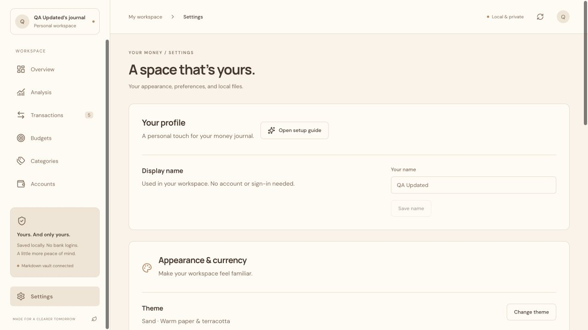
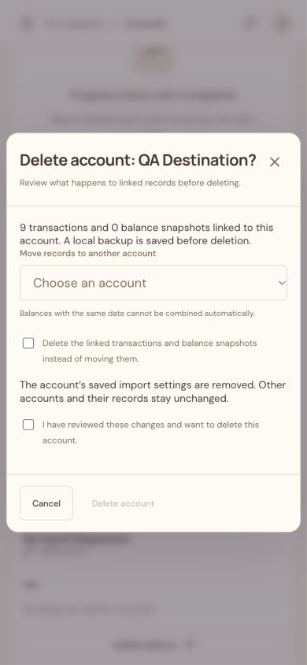

# Manual QA follow-up: fixes

The twelve findings in [the original manual report](REPORT.md) have been addressed in local source. The original report is preserved as a record of what was reproduced before the fixes.

## Changes and verification

1. **Short-window Settings:** the desktop sidebar scrolls independently. Manually reached Settings at 1280×720. Supporting sidebar content no longer makes Settings unreachable.
2. **Hidden balances blocking currency:** Review balance snapshots now selects the full balance date range, just as Review all transactions does. The October 17 snapshot appeared even after viewing September.
3. **Statement type reset:** creating a new account preserves the selected bank/credit statement type and initializes matching sign defaults. Manually verified Credit card remained selected.
4. **Unknown net worth:** no eligible balances now displays an em dash, rather than zero. The chart shows its empty state until an eligible snapshot exists. Unknown asset/debt groups also display an em dash.
5. **Notification contrast:** success notifications use white text on a dark surface in every theme. Manually checked Sand: white on RGB(37,41,56).
6. **Navigation scroll:** changing sections scrolls the page to its heading. Manually verified a zero page scroll position after navigation.
7. **Income/transfer categories:** import previews hide category selectors for these types; imported and existing loaded records consistently use an empty category. A test import produced two expense selectors and two “No category” cells, and the saved income/transfer categories were empty.
8. **Obsolete mapping errors:** changing a mapping, delimiter, or header clears the prior error. Loading the semicolon fixture reproduced the old missing-column error; correcting the separator removed it immediately.
9. **Account management:** Edit account supports name/type changes and deletion. Users choose whether to move linked records or explicitly delete them, then confirm. Moves reject colliding same-day balances and asset/debt mismatches. Import mappings reset when switching between credit-card and non-credit-card formats. Manually verified name/type editing, moving nine transactions during deletion, and explicitly deleting a separate account with four transactions and a balance.
10. **Category removal:** Edit category now includes deletion. Transactions can move to another category, subcategories are preserved as top-level categories, and deleted-category overrides are removed. Uncategorized is protected. Manually verified parent deletion preserved its child and child deletion reassigned three transactions.
11. **Forget merchant category:** the remembered-merchant table offers Forget category. Existing transactions keep their categories; an explicit “Autofill off” preference prevents historical records from immediately teaching it again. Choosing a category resumes autofill. Both persistence and subsequent manual autofill were checked.
12. **Copy and chart labels:** singular/plural wording is corrected in the reported locations, account types use friendly labels, and small net-worth chart values use currency ticks rather than fractions of thousands.

## Folder-picker and startup improvements

- Local folder selection no longer occupies the ledger request queue. A manual state read completed in **0.032 seconds while the picker was pending**.
- Settings and onboarding offer **Cancel folder picker**. Cancelling aborts the browser request and local picker process; the path field remains usable while selection is pending. Cancellation was manually verified.
- The Mac localhost helper activates Finder before requesting selection and gives specific permission/fallback guidance. OS dialog visibility could not be confirmed in this execution environment; it must not be mistaken for the independently tested Electron native picker. The app remains usable if the OS picker stalls, and a folder path can still be supplied.
- `npm start` now launches Next.js’s generated standalone server with its public/static assets. The previous unsupported-start warning disappeared in manual startup checks.

## Validation

- **93 automated tests pass**, including new record-removal, record-preservation, snapshot-collision, mapping-reset, merchant-forgetting, and import-category checks.
- Production/desktop-runtime build passes.
- Packaged-server authentication/persistence integration check passes.
- Manual browser checks cover the affected workflows above; the new deletion dialog also fitted a 390×844 mobile viewport.
- Windows execution, real OpenAI requests, signing/notarization, and installed-app update installation were not verified in this follow-up.

No real financial vault was modified. These are local changes: no commit, push, GitHub release, or replacement desktop installer was produced by this follow-up.
