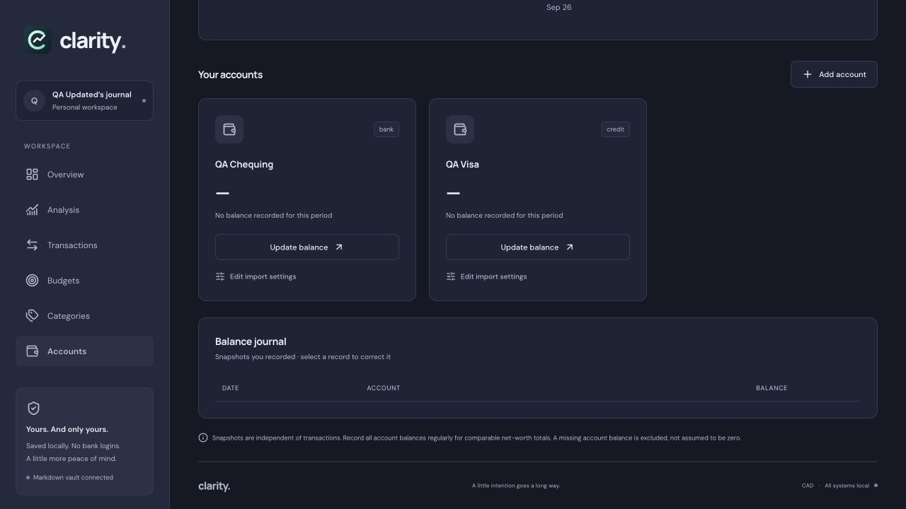
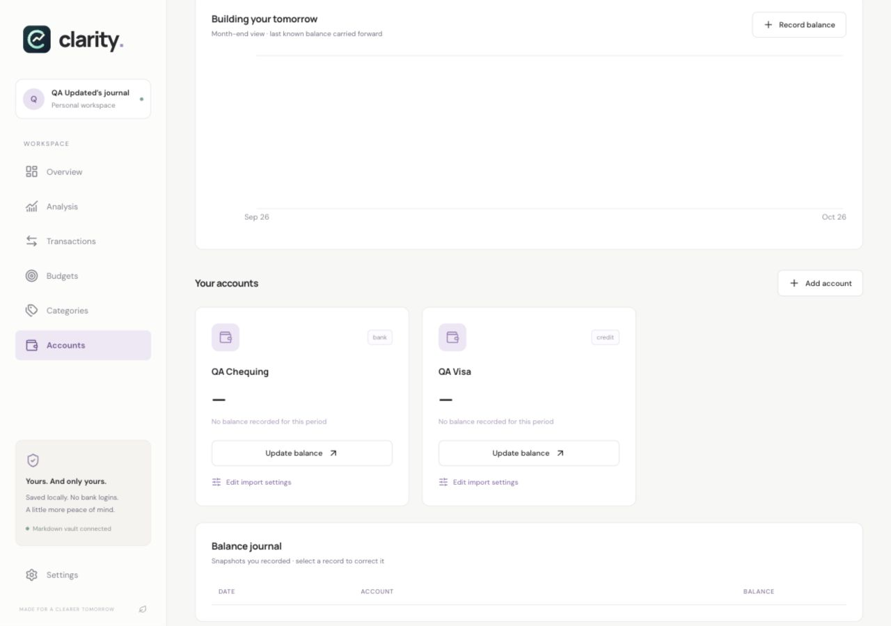
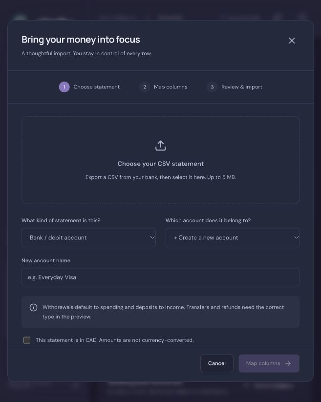
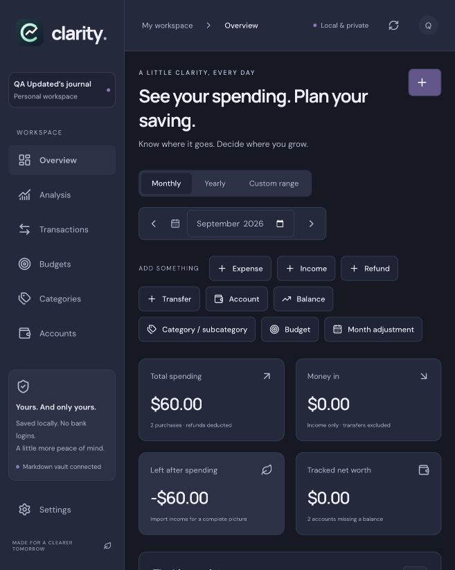
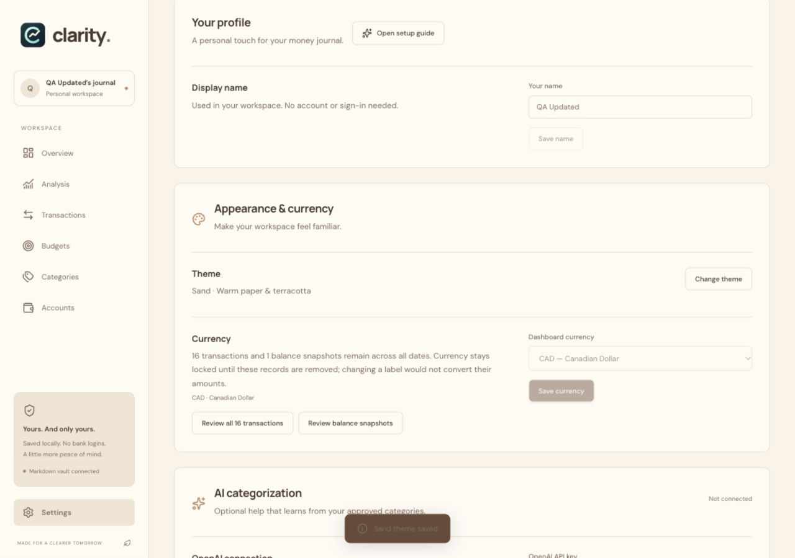
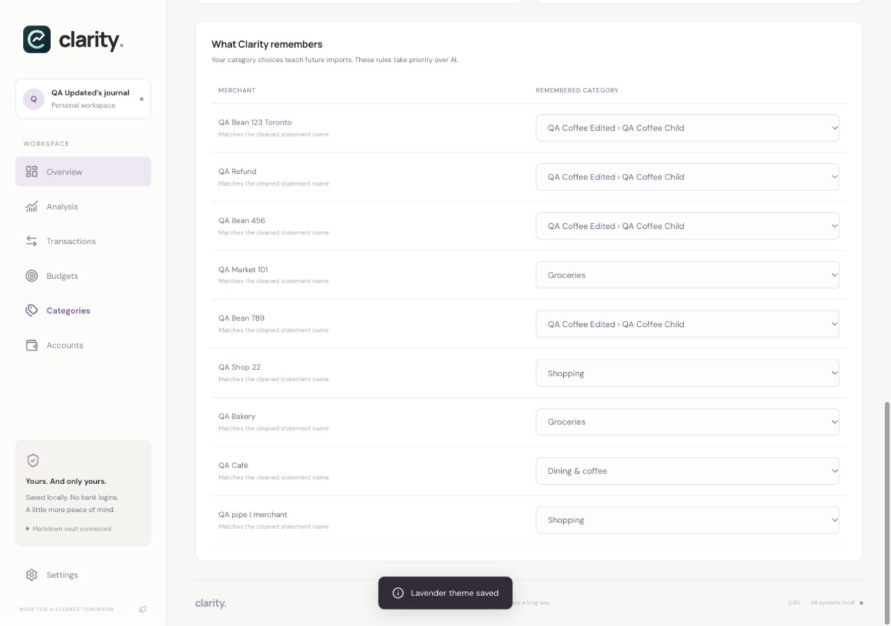
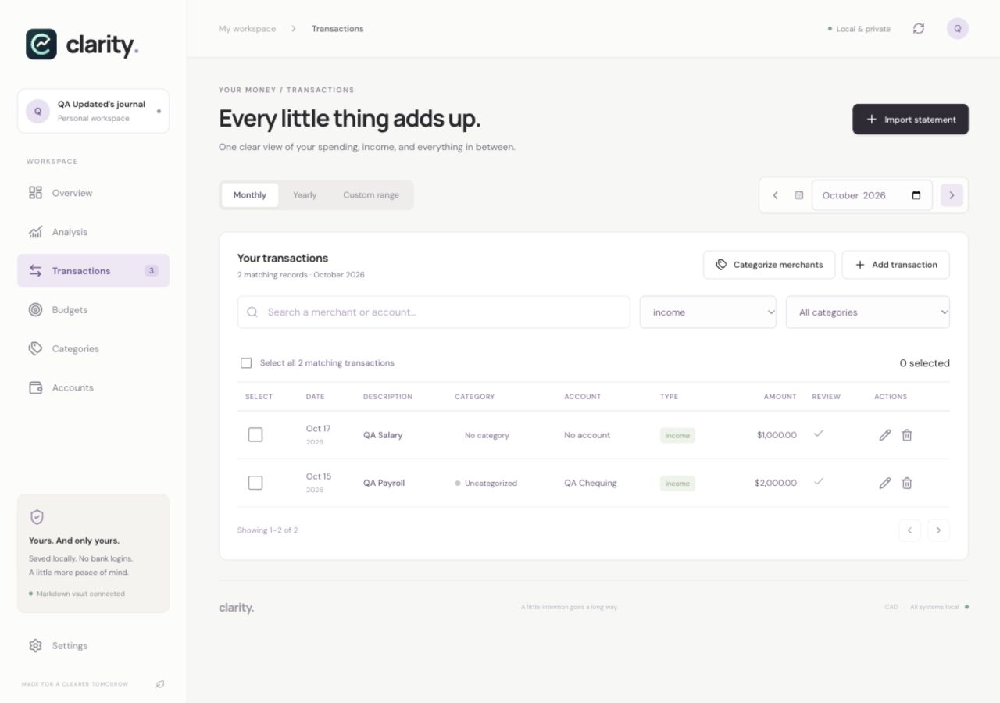

# Clarity manual QA — October 17, 2026

> **Follow-up:** see [the fixes and verification results](FIXES.md). The findings below describe the app before those local fixes.

Manually exercised the local production web app and an isolated Mac Electron instance using synthetic records. This was an interactive UI pass, with separate manual HTTP validation checks—not a unit-test run. No application fixes were made, and no real financial vault or OpenAI key was used.

## Scope and limits

- Local application version: **1.2.1**, source at **f3761b8**. Existing README and release-cleanup changes were already pending before this review.
- Browser: Chromium-based in-app browser; desktop layouts at 1280×720 and 1280×900; mobile layout at 390×844.
- Mac: Electron development shell, with its own data directory. Tested onboarding, native folder selection/cancellation, vault relocation, empty-vault currency changes, sample mode, and restart persistence.
- Seven synthetic CSV files were uploaded through the UI. Copies are in `fixtures/` alongside this report.
- **Not verified:** a fresh install of GitHub 1.2.2, Windows execution/installer/SmartScreen, Intel Mac execution, real OpenAI categorization/billing/key encryption, installed-app update download/restart, every supported date language/token, large-file limits, or crash/power-loss recovery. Development mode correctly disables update installation.
- No claim that this finds every possible defect. Findings below distinguish reproduced problems, missing UI capabilities, and environment-specific observations.

## Reproduced issues

### 1. Settings is outside the viewport in short desktop windows

**Priority: high · UI/navigation**

At **1280×720**, the Settings button begins at approximately **y=720.5** and ends at **y=763.5**. The fixed sidebar has 798 pixels of content in a 720-pixel window, but its vertical overflow is `visible`, not scrollable. Scrolling over the sidebar does not reveal Settings.

**Reproduce:** open a desktop page at 1280×720; try to reach Settings with the mouse. The local-storage card occupies the bottom of the visible sidebar and Settings is below it.

**Impact:** an ordinary short laptop/window layout can hide a primary destination. The 390-pixel mobile menu does scroll and does not exhibit this problem.

**Suggested correction:** make the desktop sidebar scrollable or keep primary navigation and Settings visible while allowing supporting content to shrink/scroll.

### 2. “Review balance snapshots” can hide the record blocking a currency change

**Priority: high · Settings/accounts workflow**

**Reproduce:** keep a balance dated **October 17**. Use a custom range ending **October 15**. In Settings, currency is correctly locked and reports one remaining balance. Click **Review balance snapshots**.

**Actual:** Accounts opens with the same custom range, and the balance journal is empty. The blocking record is invisible. By comparison, **Review all transactions** explicitly expands the range to include all transactions.

**Impact:** a user can reasonably conclude that all balances are deleted while currency stays locked. This closely resembles the earlier reported currency problem.

**Workaround verified:** switch to October monthly view, edit/delete the October 17 balance, then return to Settings. Currency unlocked and saved INR successfully once both transactions and balances were empty.

### 3. Creating an account silently resets the selected statement type

**Priority: medium · CSV import**

**Reproduce:** open Import statement, select **Credit card**, then select **+ Create a new account**.

**Actual:** statement type changes from `credit` to `bank`. The bank/debit explanatory text replaces the credit-card guidance. Reproduced both during the credit CSV import and independently afterward.

**Impact:** if unnoticed, the new import can use the wrong account/sign defaults. No incorrect ledger was saved during this test; the type was corrected before importing.

**Suggested correction:** preserve an explicitly chosen type when creating a new account, or clearly ask the user to choose again.

### 4. Unknown historical net worth is presented as $0.00

**Priority: medium · financial presentation**

**Reproduce:** have two accounts and an October 17 balance snapshot, then view September, when neither account has a known balance.

**Actual:** Overview and Accounts show **$0.00** with a missing-balances note. A completely snapshot-free vault instead shows **—**.

**Impact:** unknown net worth can be read as a measured zero. The problem is presentation, not the checked asset/liability arithmetic. The same issue produces an apparently flat historical chart before any known balance.

**Suggested correction:** show an unknown state until at least one eligible snapshot exists, and keep partial coverage visible when some accounts have balances.

### 5. Success notifications have poor contrast in several themes

**Priority: medium · UI/accessibility**

**Reproduce:** Settings → Change theme → Sand. Read the “Sand theme saved” notification.

**Actual:** its text is `rgb(132,108,89)` on `rgb(105,74,55)`, approximately **1.62:1** contrast. It is difficult to read. Rose and Sage notifications also looked faint during visual checks. Lavender used light text on a dark background and was readable.

**Suggested correction:** use a dedicated contrasting text color for notifications rather than the general muted text token.

### 6. Changing pages preserves an unrelated scroll position

**Priority: medium · UI/navigation**

**Reproduce:** scroll down Overview, then choose Categories from the sidebar.

**Actual:** Categories can open far down the page. In the recorded reproduction, the new page had `scrollY=1600` and its main heading was 1469 pixels above the viewport.

**Impact:** page headings and primary actions are hidden when entering a new section.

**Suggested correction:** scroll to the page heading on section changes, or deliberately restore a saved position for that particular section.

### 7. Income/transfer categories differ between import and manual entry

**Priority: medium · import/manual-entry consistency**

Manual income and transfer forms correctly omit Category. However, the import preview still offers category dropdowns for both, and imported records retain **Uncategorized**. The manual salary appeared as **No category**, while imported payroll appeared as **Uncategorized**. Editing an imported transfer through the manual form cleared its category.

**Impact:** the same transaction type has different data/UI behavior depending on how it was created, contrary to the requested removal of categories from income/transfers.

**Suggested correction:** hide the category selector and use the same empty category representation for these types throughout imports, editing, and storage. Keep expense/refund categories.

### 8. Mapping errors remain visible after correcting the mapping

**Priority: low · CSV feedback**

After loading a file incompatible with a saved profile, the importer correctly reports a missing saved column. Changing the delimiter and mapping so the expected columns exist updates the table and date preview, but leaves the old missing-column error visible until Preview is clicked again.

**Impact:** the screen can say a column is missing while simultaneously showing that column correctly.

**Suggested correction:** clear or revalidate the obsolete error when relevant mapping fields change.

## Missing management capabilities

These are UI feature gaps rather than failures of a button that exists.

### 9. Accounts cannot be renamed, retyped, archived, or deleted in the UI

**Priority: medium**

Account creation worked. Account cards expose **Update balance** and, after importing, **Edit import settings**. No account-edit/delete controls were available. An accidentally created or wrongly named/typed account therefore cannot be corrected from the UI and can keep appearing as a missing balance.

### 10. Categories and subcategories cannot be deleted in the UI

**Priority: medium**

Created and edited a parent and child category successfully. Category editing offers name, parent, scope, limit, and color, but no removal/archive action. Removing a budget by setting its limit to zero worked; it does not remove the category itself.

### 11. Remembered merchant rules cannot be forgotten in the UI

**Priority: low**

The remembered-merchant table allows category reassignment, which worked and affected subsequent manual autofill. There is no forget/delete control for an unwanted rule. Users can correct its category but cannot stop remembering the merchant without editing their files.

## Smaller UI polish issues

### 12. Singular wording and internal labels leak into the interface

**Priority: low**

Examples observed: **“1 matching records,” “1 purchases,” “1 accounts missing balances,”** and **“1 balance snapshots.”** Account cards also display internal type labels such as **bank** and **credit**, instead of the friendlier labels used when creating an account.

The net-worth chart for a $100 liability used ticks such as **-0.102k** and **-0.099k**. Dollar-based ticks would be easier to interpret at that scale.

## Environment-specific observations

- **Localhost folder picker:** onboarding’s Choose folder action waited and eventually showed **“Folder selection timed out. Try again.”** No usable picker appeared during that attempt. The native Electron picker opened, cancelled, selected a folder, and migrated the vault correctly. Treat the timeout as reproduced in this local execution environment, not proof that all Mac pickers fail.
- **Server startup warning:** `npm start` printed Next.js’s warning that `next start` is incompatible with `output: standalone` and recommends the standalone server entry point. The test instance still served the app. This is a packaging/start-command maintenance concern; no request failure was attributed to it in this pass.
- Plain numeric merchant suffixes such as **QA Bean 456** and **QA Bean 789** remained separate. City suffixes were extracted during import, and matching a known merchant with a city suffix in manual entry still autofilled its category. Broadly stripping all digits would need care because some merchant names legitimately contain numbers; this is a grouping limitation, not a demonstrated accounting failure.

## What passed

### Onboarding, settings, and storage

- Name entry, CAD default, theme selection, review, and finishing onboarding.
- Reloading/restarting skips completed onboarding; setup guide can be reopened from Settings.
- Profile name editing and theme popup application. Exercised Ocean, Rose, Ember, Lavender, Sage, Sand, Midnight, and Graphite across browser/native sessions.
- Currency locked while records exist; changing an empty vault to USD/INR worked.
- Browser vault relocation preserved records/preferences; native folder selection, cancellation, relocation, and restart persistence worked.
- Expected Markdown files were created; old vault folders were removed after migration; browser recovery snapshots reached the configured 30-copy limit.
- Sample workspace disables writes and exiting it restored the empty native test vault, including its USD setting.

### Create, edit, and delete

- Expense, income, refund, and transfer creation.
- Edited amounts on all four transaction types; changes appeared in the rows.
- Deleted records of all four transaction types; bulk deletion of selected expenses and later all 13 remaining records worked.
- Manual transactions were absent from Needs review immediately after creation.
- Positive amount checks, expense/refund category requirements, optional descriptions, and account-free income/refund/transfer creation.
- Exact/cleaned approved merchant autofill, remembered-rule category changes, and bulk merchant categorization.
- Account creation; balance creation, explicit same-date replacement, editing, deletion, and credit-card liability treatment.
- Parent/child category creation and editing.
- One-category and multiple-category budgets; selecting only some budgets; combined parent scopes without double counting child targets; removing a limit with zero.
- Monthly override creation, editing, removal/restoring the usual limit, and returning to the recurring budget in the next month.

### Imports and arithmetic

- `bank-mixed.csv`: named months, ISO and month-first dates; two invalid rows explained; importing required acknowledgment before skipping them.
- `credit-split.csv`: separate debit/credit columns; purchases→expense, refund→refund, repayment→transfer. September net spending was **$60 = $20 + $50 − $10**; the $200 payment was excluded.
- Saved account mappings reloaded; saved-profile editing worked; repeated bank import identified and deselected all four existing transactions.
- `european.csv`: semicolon separator, decimal comma, dotted day-first dates; amounts became **$1,234.56** and **$12.50**.
- `empty.csv` and `not-a-statement.csv`: could not silently import; useful validation messages appeared.
- `quoted.csv`: quoted comma and multiline descriptions parsed into two records.
- `unsafe-name.csv`: HTML-like merchant text rendered literally without executing; a pipe character survived Markdown save/reload and search.
- Initial October totals reconciled to **$82.75 spending** and **$3,000 income**; transfers were excluded and refunds deducted. Later fixture additions also reconciled before CRUD cleanup.

### Charts, dates, and responsive behavior

- Analysis chart pin/hide/restore; pinned layout persisted on reload.
- Category comparison changes, six-month trends, yearly selector, and Current year reset.
- A reversed custom range entered with native keyboard controls showed the validation message instead of chart results.
- Ocean and Midnight chart tooltips used their corresponding surface colors. Dark tooltip evidence is saved in `images/dark-tooltip.png`.
- Mobile navigation, expandable Add something, transaction filters/cards, and transaction dialog fitted 390×844. No page-level horizontal overflow was observed in that transaction view.
- No browser warning/error logs were captured during the checked session.

### Manual backend checks

- State read: **200**.
- Write without the required UI token: **403**.
- Currency change while transactions/balances exist: **400** with remaining-record counts.
- Negative stored transaction amount: **400**.
- Stale revision save: **409** with refresh guidance.
- Desktop-update endpoint in browser/server mode: **404** as expected.

These were direct requests against the disposable test instance, not a substitute for the UI scenarios above.

## Test data and cleanup

All test instances were stopped. The normal installed Clarity process and real vault were left alone. The browser test vault ended empty of transactions/balances with INR saved; a synthetic ledger copy was preserved before the full-delete test at `/tmp/clarity-manual-qa/vault-before-emptying`. Native test settings/vault remain under `/tmp/clarity-manual-qa/desktop-data` and `/tmp/clarity-manual-qa/desktop-selected`.

Only this report, synthetic fixtures, and screenshots were added for the review. No application fixes, commits, pushes, or release builds were performed.
